# Database foundation

## Status and conventions

[Initial SQL](../database/migrations/001_initial.sql) targets **MySQL 8.4 LTS,
InnoDB**. It is an undeployed initial migration, not a connected persistence
implementation. The [example seed](../database/seeds/001_example_catalog.sql)
contains eight illustrative missions, not enough to guarantee full hands for
a multiplayer game. It preserves useful text from the old example, excluding
the two physical-lifting/inversion tasks. Review all catalog content before
launch. No user records or passwords are retained.

Use a fresh, explicitly approved disposable database with strict SQL mode,
foreign-key/check enforcement enabled, and UTC sessions. No `CREATE DATABASE`,
database credentials or database installation are included. Apply the migration
once, then the seed once; rerunning intentionally fails rather than silently
overwriting existing data. MySQL DDL implicitly commits: a migration failure
can leave a partial schema. Do not retry blindly or use a live database.

IDs are `BINARY(16)` UUID bytes with one consistent, unswapped encoding, generated
by the future API. Fixture IDs are deterministic and are not secrets. Message IDs
are global auto-increment cursors; every message query must also scope by game.
Dates are UTC `DATETIME(3)`. Text uses `utf8mb4_0900_as_cs`; nickname keys and
leaderboard aliases use accent-sensitive, case-insensitive
`utf8mb4_0900_as_ci`. API validation must normalize Unicode to NFC, reject
controls and trim/validate input; SQL nickname checks also reject outer ASCII
spaces. A nickname and alias must not be used as identity credentials.

All foreign keys use restrictive default actions. Cleanup is an explicit
child-first transaction, not hidden cascading behavior. Composite foreign keys
include game ID wherever related rows must belong to the same game.

## Diagram



[Open SVG](database.svg) | [Authoritative Mermaid ER source](database.mmd)

The diagram shows key columns; SQL defines every column, type and constraint.
`UK` on a field may denote a **game/pack-scoped composite** unique key, not
global uniqueness. Five slots/exactly one host/minimum one offer item also need
service enforcement; diagram cardinality expresses the intended model, not a
claim that foreign keys alone implement those minimums.

To render with Node.js 22 and npm from the repository root:

```powershell
npm exec --yes --package=@mermaid-js/mermaid-cli@11.12.0 -- mmdc -i docs\database.mmd -o docs\database.svg -b white
```

This fetches pinned documentation tooling (and its browser dependency), not an
application dependency or database. Do not send source to an online diagram
service. Regenerate the SVG after changing Mermaid, then inspect labels,
relationships and readability. The SVG is generated output, never hand-edited.

If Node does not recognize your organization's certificate issuer, enable its
system certificate store for that PowerShell process with
`$env:NODE_OPTIONS = '--use-system-ca'` (requires a Node release supporting that
flag); never disable TLS verification. If Puppeteer's bundled browser is
unavailable, point it at an existing trusted browser before rendering, for
example:

```powershell
$env:PUPPETEER_EXECUTABLE_PATH = 'C:\Program Files (x86)\Microsoft\Edge\Application\msedge.exe'
```

The checked-in SVG was rendered locally using this installed-browser route.
Mermaid source fixes generated IDs and the drawing seed; two renders with the
same renderer/browser/fonts produced byte-for-byte identical output.

## Table dictionary

### mission_packs

Reusable content or an isolated game draft. `kind` is `builtin`, `game_draft`,
or `private_saved`. Built-ins have a unique `catalog_key` and no owner secret;
drafts have neither; saved private packs have only a unique
`ownership_secret_hash`. `title` (120 characters), `description` (2000),
`revision` and created/updated times support editing. The application sets
`updated_at` and increments revision on accepted edits.

There is no saver player/device column and no public listing of private packs.
A saved copy does not depend on a membership that will expire. An independent
copy gets new IDs and secret. Catalog/private content can change without
changing existing game copies.

### missions

Content rows belonging to one `pack_id`: stable `id`, unique one-based
`position` per pack, `mission_text` (1000 characters) and created/updated times.
Copying a pack copies its mission rows. No many-to-many table is necessary:
there is no requirement for synchronized mission edits across packs.

There is **no global active/assigned flag**.

### games

Unique `join_code` (8-12 ASCII characters; future API uses uppercase random
alphanumerics), unique `draft_pack_id`, `state`, frozen pack title/description,
fixed initial rule parameters, revision and lifecycle timestamps.

`expires_at` is explicit, indexed with state, and must exceed
`last_activity_at`. The future service must set the exact 30-day inactivity or
seven-day ended deadline. SQL does not infer/refresh it.

The unique draft reference prevents sharing drafts between games. The future
create transaction must verify `kind = game_draft`; a foreign key to a pack
alone does not enforce its kind. Do not retain an ownership/provenance foreign
key to a source private pack: deleting it must not block or affect its copies.

Lobby has no frozen metadata/start/end time; active has frozen metadata and a
start time; ended also has an end time. A lobby is not "ended": if abandoned it
expires, with no final gameplay state. An explicit lobby-cancel feature is not
implemented.

### game_players

Anonymous membership: `id`, `game_id`, fixed `nickname` (32 characters),
generated normalized `nickname_key`, `leaderboard_alias` (48),
`membership_secret_hash`, role, selection progress, `resolution_count`,
`target_cycle`, and join time.

`(game_id, nickname_key)` and `(game_id, leaderboard_alias)` are unique.
Generated nullable `host_game_id` gives an ordinary MySQL unique-index guard
for **at most one** host. The create transaction ensures **at least one**.
There is no host-to-player/game foreign-key cycle.

`selection_complete` is historical initial-deal progress, not a check that five
slots are currently occupied. An incomplete hand after exhaustion is valid.
No score column: derive score from successful assignments.

### game_missions

Immutable game-local mission text and position copied at start. No source
foreign key or mutable content link. The game-scoped unique position identifies
each frozen entry. Availability is **derived** by absence of an assignment,
using an indexed anti-join against `(game_id, game_mission_id)`:

```sql
SELECT gm.id, gm.mission_text
FROM game_missions AS gm
WHERE gm.game_id = ?
  AND NOT EXISTS (
      SELECT 1 FROM mission_assignments AS ma
      WHERE ma.game_id = gm.game_id AND ma.game_mission_id = gm.id
  )
ORDER BY gm.position
LIMIT ?;
```

This illustrates availability, not randomized dealing. Future dealing must
choose randomly without loading the whole catalog or relying on a full-table
`ORDER BY RAND()` at scale. There is no separately maintained availability
column that can disagree with assignments.

### player_slots

Composite primary key `(game_id, player_id, slot_number)`, range 1-5, nullable
`cooldown_until`. Join initializes five rows. Null means no cooldown yet.
Only the service enforces exactly five rows, server-time eligibility and
cooldown progression.

### mission_assignments

One lifetime claim of `game_mission_id`, owner `player_id`, slot, status,
assigned/resolved times, target kind/player/cycle, and comments (2000).

- Unique `(game_id, game_mission_id)` prevents reuse even after resolution.
- Generated nullable `open_slot_number` plus a unique composite key permits at
  most one open assignment per player's slot while retaining old results.
  This is a MySQL-safe substitute for a partial unique index.
- Slot and mission foreign keys prohibit cross-game assignment.
- Player targets reference a member in the same game and cannot equal owner.
- Open/failed rows have no target/comment; open has no resolution time.
  Completed has a resolution time and either Group or an individual target
  plus positive cycle. SQL checks use explicit null tests to avoid CHECK's
  three-valued-logic loopholes.
- SQL cannot prevent changing a resolved row back to open. The future service
  uses conditional updates, permissions and transactions; no triggers exist.

Resolved rows form the temporary server wallet. Local history snapshots their
text and display metadata before cleanup. No extra wallet/leaderboard table.

### selection_offers and selection_offer_items

Offer identifies player/slot, `initial`/`refill`, current/consumed/superseded
state, revision and times. One generated nullable key permits one current
offer per player. A consumed offer references an assignment in its same
game/player/slot; current/superseded offers do not.

Items use position 1-2 and unique mission per offer. This enforces **at most
two**, not a minimum of one. Do not create empty current offers; exhaustion is
an explicit response. Offers can overlap between players and are not locks.
The consumed assignment must be checked against offered candidates by the
service; the slot-scoped foreign key alone does not enforce that.

### player_target_hits

Unique `(game_id, actor_player_id, target_player_id, cycle_number)` is the
target-rotation ledger. A unique assignment reference prevents duplicate hits.
Its composite assignment foreign key matches actor, target and cycle, not just
assignment ID; this can only reference an individual completed assignment.
Actor and target must be different and belong to the same game.

The resolution transaction must insert the hit for every individual success.
SQL does not force every assignment to have its corresponding ledger row or
compute when a cycle is complete. Group creates no hit.

### game_messages

Ordered `id`, game, optional sender, kind, `message_text` (2000), optional
assignment and timestamp. Chat requires a sender and no assignment; system
results require an assignment and no sender. Unique `(game_id, assignment_id)`
prevents duplicate result messages while allowing many chat messages.

The service verifies that result kind matches assignment status and builds
bounded result text from the resolved mission, actor and target. Project the
optional result comment separately from the resolved assignment; do not
concatenate a 2000-character comment into an already populated 2000-character
message field or truncate it silently. Sender and assignment foreign keys
enforce same-game references, not viewing permissions. Fetch by `game_id` and
`id > cursor` with a bounded limit, never a global feed.

### mutation_receipts

Primary key `(game_id, player_id, request_id)` (64-character ASCII request ID),
action (`claim`, `resolve`, `save_pack`), SHA-256 request fingerprint, result
resource ID, result revision and time. Reusing an ID with a different
action/payload is a conflict, not a successful retry.
For claim/resolve, the result revision is the committed game revision; for
save-pack it is the new pack's content revision.

Result resource is intentionally **not a foreign key**: a saved independent
pack may be deleted while the receipt remains. A retry returns the recorded
operation/result identity; if that resource was explicitly deleted, report it
as deleted rather than recreating it. No raw tokens or unbounded responses in
receipts.

For retry-safe pack saving, the client supplies a newly generated ownership
secret and retains it locally across retries. The service hashes it; the
fingerprint incorporates its digest, not its raw value. A lost response must not
require storing a retrievable raw secret on the server.

Creation, joining, editing, chat, starting/ending and private-pack management
need separately specified retry contracts in the future API phase; this table
does not pretend to implement every endpoint's idempotency.

## Transaction contracts

These are requirements for the **future backend**, not stored procedures or
implemented endpoints. Use a consistent lock order: game row first, then actor
membership, slot, offer/mission rows. Game-level write serialization initially
makes joins and target-cycle checks deterministic; revisit only after measured
contention. Read authorization checks must not accidentally expose frozen
catalog text or open assignments.

1. **Create**: insert isolated `game_draft` plus content, lobby game and host
   membership/five slots atomically. Collision-check random code and nickname/
   alias/secret uniqueness. Initialize expiry to activity + 30 days.
2. **Join**: lock game, reject expired/ended; allow lobby/active. Validate
   nickname and deduplicate retried admission before creating a membership
   and five slots. Assign a fresh game-local alias and secret. A shortage of
   available missions is not a failed join.
3. **Edit/start**: authorize host. Edit only lobby draft using expected revision,
   advancing game/pack revision and activity. Start locks the draft, validates
   nonempty content and copies all missions and pack metadata in one transaction.
   Do not change source/private packs or allow active-game edits.
4. **Offer/claim**: authorize owner and active/unexpired game; check slot is
   empty and cooldown passed using server UTC. Replace/supersede prior current
   offer atomically. Claim requires current offer revision and offered mission,
   then inserts the unique assignment, consumes offer, updates progress and
   activity/revision, and writes receipt in the same commit. Unique conflict
   means refresh available candidates; never pretend a claim succeeded.
5. **Resolve**: authorize owner; lock game/member/slot and open assignment.
   On individual success, compare hits against the current joined roster;
   if the previous cycle is complete, advance it before accepting the next hit.
   New arrivals before that transaction join the current roster; Group neither
   advances nor resets it. Insert assignment result, target hit if applicable,
   slot cooldown, resolution-count increment, system message and receipt
   atomically. Failure has no target/comment. The unique/conditional update
   prevents repeated resolution. Calculate cooldown before incrementing count,
   clamping count at 7 for the exponent before applying the 360-minute cap.
6. **Chat**: authenticate membership, validate nonblank/bounded text and active
   game, insert once using the future chat retry contract; update activity.
   Publish only after commit. Realtime delivery cannot be the only history.
7. **End**: host-only conditional active-to-ended transition, ending/revision
   timestamps and expiry = end + 7 days. Freeze gameplay/chat/configuration
   writes. Reads and allowed pack-copy saves never extend this deadline.
8. **Save pack**: host can explicitly copy its lobby draft or frozen pack.
   Others must be members of an ended/unexpired game. Save full content with
   new IDs, private kind and new ownership digest. Commit copy and receipt
   together. Do not copy assignment ownership or link to saver membership.
   Anyone with the saved pack's ownership secret can later manage/reuse it;
   copying into a new game again creates independent draft/content.
9. **Delete private pack**: verify ownership secret and kind, lock pack,
   delete its missions then pack in one transaction. Existing game snapshots
   and saved copies are independent. Receipt resource IDs do not block deletion.

All game-scoped successful state writes advance `games.revision`. Selection
reads that create/supersede offers are writes and count as activity; ordinary
reads/reconnects do not. Server confirmation precedes optimistic local history
being marked final. Deadlocks roll back and retry using the same request ID.

### Cleanup order

The future worker selects expired games by `(state, expires_at, id)`, locks each
game and rechecks expiry. In a bounded per-game transaction:

1. Remember the game's draft pack ID.
2. Delete `game_messages`, `mutation_receipts`, `player_target_hits`.
3. Delete `selection_offer_items`, then `selection_offers`.
4. Delete `mission_assignments`, then `player_slots`.
5. Delete `game_missions`, then `game_players`, then `games`.
6. Delete `missions` for the remembered draft, then that `game_draft` pack.

Everything is filtered by the locked game/draft, with explicit kind checks.
Never disable foreign keys. Use bounded game-size limits before launch so
one game's cleanup transaction remains practical; larger games may need an
explicit purging state/child batching in a later migration.

Saved private packs have no game/saver foreign key and survive. When row cleanup
is delayed, every API read/write/subscription must still reject expired access.
Log/backup retention is a separate operations requirement.

## Validation

`node --test tools\foundation.test.mjs` checks repository retirement, instruction
discovery/links, SQL/diagram table and column consistency, foreign-key target
keys, game scoping, critical declared constraints, seed shape, and rendered SVG
presence. These are structural regression checks, **not a SQL parser or engine**.

MySQL 8.4 is not installed/configured for this foundation. Migration/seed
execution, constraint behavior, query plans, cleanup and concurrent service
transactions have **not** been runtime-tested. No substitute SQLite run or
regex test is claimed as proof of MySQL correctness.

Before connecting a backend, use an approved disposable MySQL 8.4 target to
execute the migration and seed and run the following cases:

| Scenario | Enforcement / required future verification |
| --- | --- |
| Migration and seed execute once; replay fails clearly | MySQL engine; inspect schema after DDL failure |
| Same nickname with case changes in one game rejected; another game accepted | Unique nickname key; verify collation/NFC API validation |
| Second host rejected, game cannot be created without host | Unique generated key; create transaction for minimum one |
| Cross-game slot/mission/target/offer/message reference rejected | Composite foreign keys |
| Two concurrent claims yield one assignment | Unique claim plus service transaction |
| Two open assignments in one slot rejected; resolved history coexists | Generated nullable slot unique key |
| Slot 0/6 or offer item 0/3 rejected | CHECK constraints |
| Open/failed targets, self-target, malformed result fields rejected | CHECK and target FKs |
| Resolution cannot be undone/replayed or skip a hit/message | Conditional service update + receipt + ledger transaction |
| Mid-game join participates in current target cycle | Game lock + roster/cycle transaction |
| Initial/refill shortage returns 0/1/2 candidates, not an error-shaped success | Future API and device UI |
| Early refill rejected at 5/10/.../360-minute boundaries | Server clock/service tests; SQL stores deadline only |
| Concurrent draft edit/start cannot mutate frozen content | Revision/locking/service tests |
| Nonhost cannot read/edit draft or save full pack while active | Authorization tests; not a DDL guarantee |
| Post-end participant save reveals full pack, never assignment mapping | Authorization/projection + copy transaction |
| Retried pack save produces one copy and preserves client-held secret | Receipt/fingerprint + transaction |
| Reads do not prolong deadlines; 7/30-day access rejected on boundary | Clock/lifecycle API tests |
| Purge removes every game row and draft, preserves independent copies | Execute documented cleanup against fixtures |
| Deleting a saved source cannot change its copies or be blocked by receipts | Restrictive-key review + cleanup/private delete tests |
| Private events and historical exports exclude other players' open missions | Future API/realtime/device tests |

The future API needs parameterized queries, bounded payloads/rates, indexes
verified with `EXPLAIN`, and load tests. This schema is a foundation for scaling,
not a measured capacity claim.
