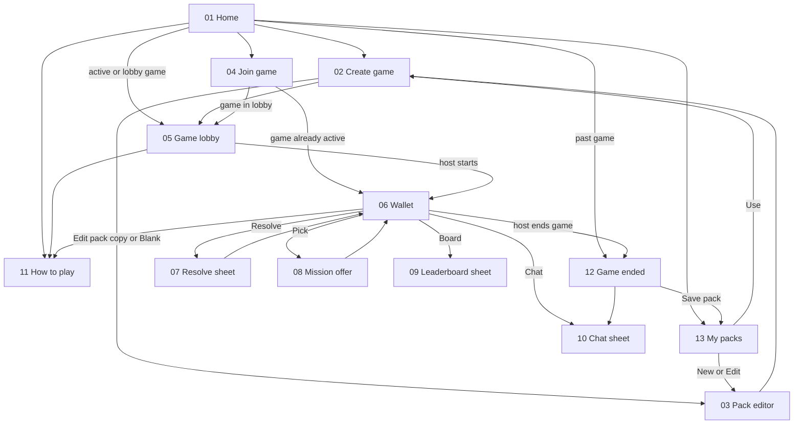

# Mobile wireframes

Low-fidelity, grayscale, phone-portrait (390x844) wireframes for the Gotcha
mobile app. They show layout, content and flow only. They do not set visual
design, branding, typography or motion.

The [game rules](../game-rules.md) and [architecture](../architecture.md) take
priority. If a wireframe disagrees with them, fix the wireframe.

Dashed boxes labelled **WIREFRAME NOTE** explain behaviour. Boxes labelled
**VARIANT** show another state of the same screen. Neither is UI.

## Navigation



## Screens

| Screen | Purpose | Entry → exit | Shows | Privacy | Variants |
| --- | --- | --- | --- | --- | --- |
| [01 Home](01-home.svg) | List this device's games; create or join | App launch → Create, Join, My packs, Rules, a game | Active and lobby games first, then past games from device history | Lists only games this device joined | Empty home |
| [02 Create game](02-create-game.svg) | Host picks a nickname and one pack | Home, My packs (Use) → Pack editor, Lobby | Built-in, saved and blank pack sources | Only the host sees the pack | — |
| [03 Pack editor](03-pack-editor.svg) | Host edits the game's own copy, or a saved pack | Create game, My packs → back | Title, description, ordered missions | Host only; frozen when the game starts | — |
| [04 Join game](04-join-game.svg) | Enter code and per-game nickname | Home → Lobby or Wallet | Code, nickname, inline errors | Nickname unique per game, case-insensitive | Inline errors (taken nickname shown) |
| [05 Game lobby](05-game-lobby.svg) | Share code and wait for start | Create, Join, Home → Wallet | Join code, roster, pack summary | Roster uses nicknames; non-hosts never see the pack | Non-host view (in note) |
| [06 Wallet](06-wallet.svg) | Main in-game screen | Lobby, Join, Home → Resolve, Offer, Board, Chat, Rules, Ended | Score, five slots, wallet history | Never shows other players' missions | Cooldown slot |
| [07 Resolve sheet](07-resolve-mission.svg) | Mark a mission succeeded or failed | Wallet → Wallet | Target chips, optional comment | Result is posted to chat | Fail mode (in note) |
| [08 Mission offer](08-mission-offer.svg) | Choose one of two offered missions | Wallet (Pick) → Wallet | Two options | Offers are not reserved | One left, pool exhausted |
| [09 Leaderboard sheet](09-leaderboard-sheet.svg) | Ranked scores | Wallet, Game ended → back | Aliases and scores | Random per-game aliases, not nicknames | Final standings (in note) |
| [10 Chat sheet](10-chat-sheet.svg) | Group chat and result posts | Wallet, Game ended → back | Messages and result cards | Members only, nicknames | Read-only after end (in note) |
| [11 How to play](11-rules.svg) | Short rules summary | Home, Lobby, Wallet → back | Goal, slots, scoring, cooldowns, ending | — | — |
| [12 Game ended](12-game-ended.svg) | Final summary and save-pack prompt | Wallet (host ends), Home (past game) → My packs, Chat | Final board, own missions, save prompt | Saving shows the full pack, never who had which mission | Incomplete results (in note) |
| [13 My packs](13-saved-packs.svg) | Manage private packs saved on this device | Home, Game ended → Create, Pack editor | Saved packs with Use, Edit, Delete | Controlled by a device-held secret; no recovery | Delete confirmation |

## Out of scope

Tablet and landscape layouts, dark mode, branding and visual design, animation,
onboarding, app settings, notification permission prompts, and separate
error or offline screens (errors use inline patterns, see Join game).

## Regenerating

The SVGs are generated and must not be edited by hand. Change
[`tools/wireframes.mjs`](../../tools/wireframes.mjs), then run from the
repository root:

```powershell
node tools\wireframes.mjs
node --test tools\foundation.test.mjs
```
