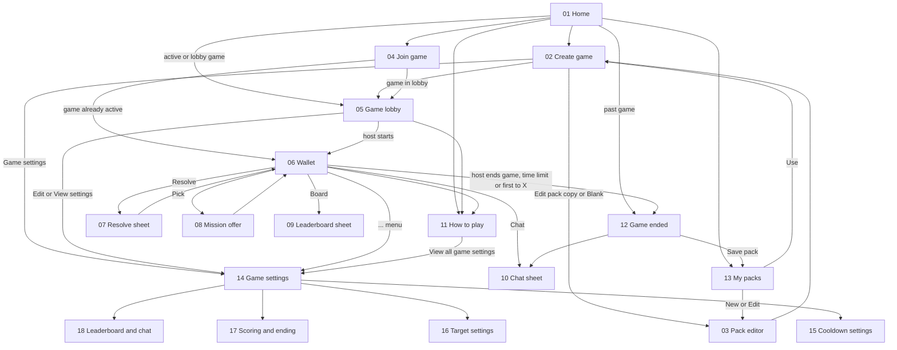

# Mobile wireframes

Low-fidelity, grayscale, phone-portrait (390x844) wireframes for the Gotcha
mobile app. They show layout, content and flow only. They do not set visual
design, branding, typography or motion.

The [game rules](../game-rules.md) and [architecture](../architecture.md) take
priority. If a wireframe disagrees with them, fix the wireframe.

Dashed boxes labelled **WIREFRAME NOTE** explain behaviour. Boxes labelled
**VARIANT** show another state of the same screen. Neither is UI.

## Navigation



## Screens

| Screen | Purpose | Entry → exit | Shows | Privacy | Variants |
| --- | --- | --- | --- | --- | --- |
| [01 Home](01-home.svg) | List this device's games; create or join | App launch → Create, Join, My packs, Rules, a game | Active and lobby games first, then past games from device history | Lists only games this device joined | Empty home |
| [02 Create game](02-create-game.svg) | Host picks a nickname, one pack and game settings | Home, My packs (Use) → Pack editor, Game settings, Lobby | Built-in, saved and blank pack sources; settings summary (defaults) | Only the host sees the pack | — |
| [03 Pack editor](03-pack-editor.svg) | Host edits the game's own copy, or a saved pack | Create game, My packs → back | Title, description, ordered missions with a Group OK flag | Host only; frozen when the game starts | — |
| [04 Join game](04-join-game.svg) | Enter code and per-game nickname | Home → Lobby or Wallet | Code, nickname, inline errors | Nickname unique per game, case-insensitive | Inline errors (taken nickname shown) |
| [05 Game lobby](05-game-lobby.svg) | Share code and wait for start | Create, Join, Home → Wallet, Game settings | Join code, roster, pack and settings summaries | Roster uses nicknames; non-hosts never see the pack | Non-host view (in note) |
| [06 Wallet](06-wallet.svg) | Main in-game screen | Lobby, Join, Home → Resolve, Offer, Board, Chat, Rules, Game settings, Ended | Score, end conditions, configured slots (default five), wallet history; Board hidden when the leaderboard is off | Never shows other players' missions | Cooldown slot |
| [07 Resolve sheet](07-resolve-mission.svg) | Mark a mission succeeded or failed | Wallet → Wallet | Target chips (Group only for Group OK missions), target-rule hint, optional comment | Result is posted to chat | Fail mode (in note) |
| [08 Mission offer](08-mission-offer.svg) | Choose one of the offered missions | Wallet (Pick) → Wallet | Offer size options (1-3, default two), Reroll when enabled | Offers are not reserved | One left, pool exhausted |
| [09 Leaderboard sheet](09-leaderboard-sheet.svg) | Ranked scores | Wallet, Game ended → back | Aliases or nicknames, and scores | Mode is a setting: anonymous (default), nicknames or off | Nicknames mode |
| [10 Chat sheet](10-chat-sheet.svg) | Group chat and result posts | Wallet, Game ended → back | Messages, result cards and settings-change posts | Members only; messages use nicknames, result posts use the leaderboard identity | Chat off read-only feed, read-only after end (in note) |
| [11 How to play](11-rules.svg) | Rules summary filled in with this game's settings | Home, Lobby, Wallet → Game settings, back | Goal, slots, targets, scoring, cooldowns, ending | — | — |
| [12 Game ended](12-game-ended.svg) | Final summary and save-pack prompt | Wallet (host ends), Home (past game) → My packs, Chat | End reason, final board revealed with nicknames, own missions, save prompt | Saving shows the full pack, never who had which mission | Incomplete results (in note) |
| [13 My packs](13-saved-packs.svg) | Manage private packs saved on this device | Home, Game ended → Create, Pack editor | Saved packs with Use, Edit, Delete | Controlled by a device-held secret; no recovery | Delete confirmation |
| [14 Game settings](14-game-settings.svg) | Overview of all per-game settings | Create, Lobby, Wallet (...), How to play → detail screens, back | Wallet steppers, rule group summaries, joining | Host edits; players view read-only | During play: locked rows |
| [15 Cooldown settings](15-cooldown-settings.svg) | Configure cooldown times | Game settings → back | Base, scaling, multiplier or step, cap, failures toggle, preview | — | Cooldowns off |
| [16 Target settings](16-target-settings.svg) | Choose the repeat rule for targets | Game settings → back | Four rules, X stepper, example | Enforced by player ID | — |
| [17 Scoring and ending](17-scoring-ending.svg) | Failure scoring and automatic endings | Game settings → back | Failure points, negative toggle, time limit, first to X | — | First to X set |
| [18 Leaderboard and chat](18-leaderboard-chat.svg) | Leaderboard and chat visibility | Game settings → back | Board mode, chat toggle, result posts, post names | Names always revealed after the end | Switch-to-nicknames warning |

Settings default to the values in [game rules](../game-rules.md#game-settings).
Screens 06-12 show the defaults, plus a time limit and first to 10 on the
wallet. Settings marked live stay editable for the host during play.

## Out of scope

Tablet and landscape layouts, dark mode, branding and visual design, animation,
onboarding, app settings, notification permission prompts, and separate
error or offline screens (errors use inline patterns, see Join game).

## Regenerating

The SVGs are generated and must not be edited by hand. Change
[`tools/wireframes.mjs`](../../tools/wireframes.mjs), then run from the
repository root:

```powershell
node tools\wireframes.mjs
node --test tools\foundation.test.mjs
```
